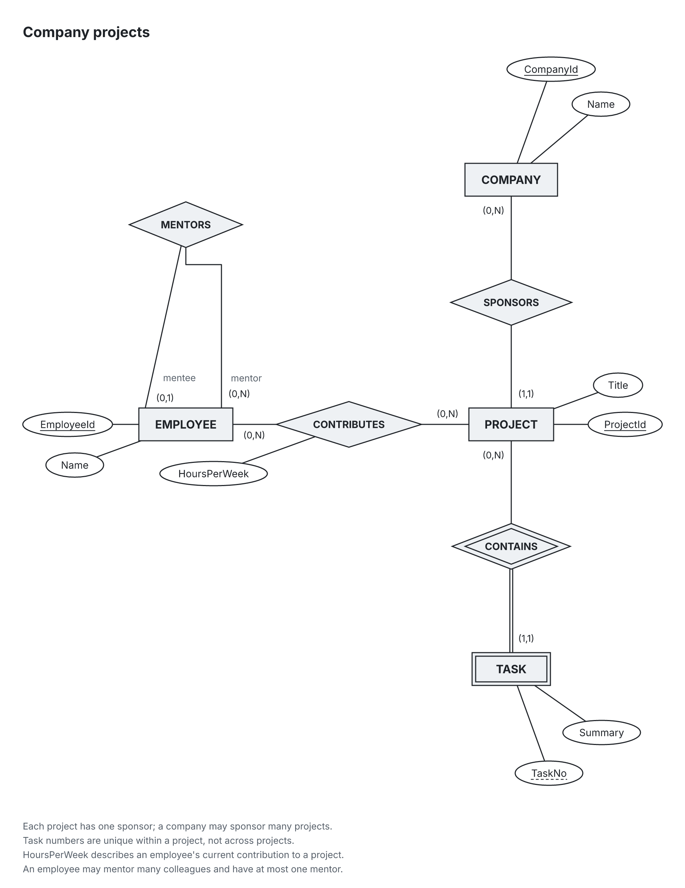
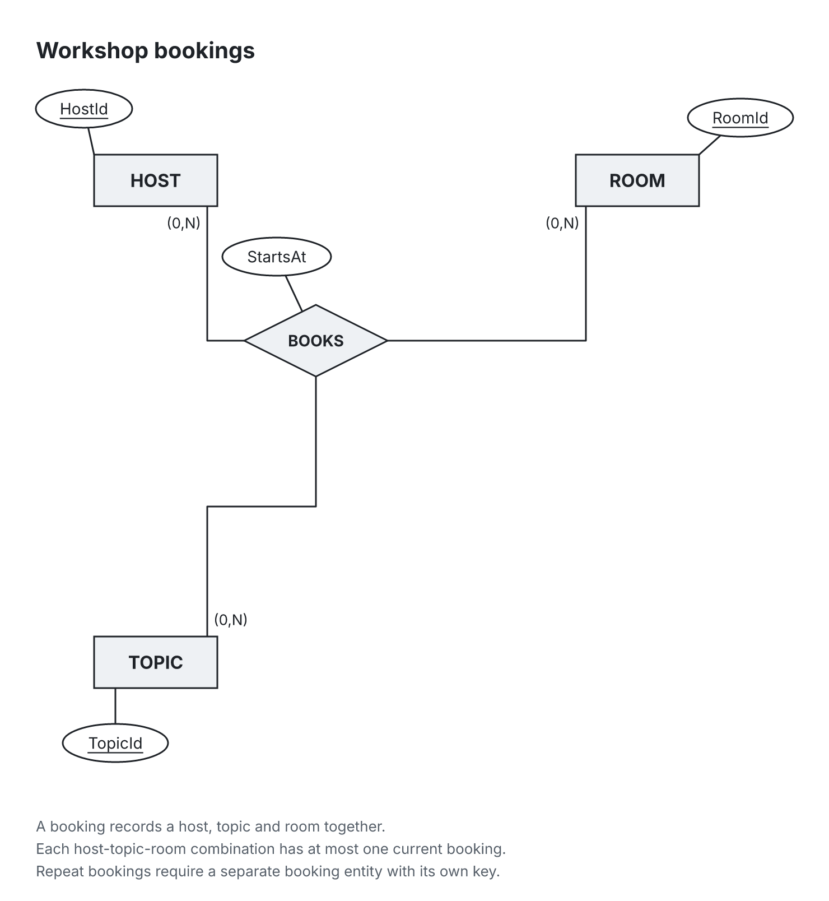

# chen-er

chen-er turns YAML database models into Chen entity–relationship diagrams, checks structural and semantic rules, and exports SVG and PNG. Entities, candidate keys, weak entities, relationship attributes, recursive roles and n-ary relationships stay explicit in the source. Use the CLI, a local viewer or MCP tools to revise the model and inspect the result. `(min,max)` labels describe the participation of the entity at that end.



[SVG](docs/company-project.svg) · [YAML source](examples/company-project.er.yaml)

Use Node.js 24 or newer. Install the npm package `chen-erd` to get the `chen` command (the project name remains chen-er):

```sh
npm install -g chen-erd
chen init model.er.yaml
chen render model.er.yaml --png
```

## Write YAML → get a diagram

This ternary relationship records a host, topic and room together. The snippet omits the source's explanatory notes.

<table>
<tr><th>YAML</th><th>Rendered diagram</th></tr>
<tr><td><pre lang="yaml">version: 1
title: Workshop bookings
entities:
  HOST: {attrs: [HostId], keys: [[HostId]]}
  TOPIC: {attrs: [TopicId], keys: [[TopicId]]}
  ROOM: {attrs: [RoomId], keys: [[RoomId]]}
relationships:
  BOOKS:
    ends:
      - {entity: HOST, card: "0..N"}
      - {entity: TOPIC, card: "0..N"}
      - {entity: ROOM, card: "0..N"}
    attrs: [StartsAt]</pre></td><td></td></tr>
</table>

[Full source](examples/ternary.er.yaml) · [SVG](docs/ternary.svg) · [Library example](examples/library.er.yaml)

## Lint before rendering

An identifying relationship is required for a weak entity. Run the checked-in, intentionally invalid [lint example](docs/lint-example.er.yaml):

```sh
npx chen-erd lint docs/lint-example.er.yaml
```

Actual CLI output (exit code 1):

```text
error:4:11 [weak-without-identifying] Weak entity TASK has no identifying relationship.
  hint: Add a relationship connecting TASK to its owner and set identifies to TASK.
0 errors does not mean the model is right; it means nothing obviously wrong was found.
```

Diagnostics include source positions, rule ids, severity and repair hints. There are five severities. `error` marks a malformed model or a broken ER rule and is the only one that makes `chen lint` and `chen render` exit with code 1. `warning` reports an operational problem with the rendering rather than the model, for example saved layout pins that make the drawing clearly worse (`pins-degrade-layout`); it is always shown, and `--no-course` and `--no-heuristic` do not hide it. `course` marks a course-convention issue (`--no-course` hides it), `heuristic` a modelling-quality suspicion (`--no-heuristic` hides it) and `info` a hint. `chen render --no-pins` ignores the layout file (pins, saved positions and stored engine) without modifying it, which helps to compare against a `pins-degrade-layout` warning. A clean lint result does not establish domain correctness.

## Agents: skill and MCP

The repository [er-diagram skill](skills/er-diagram/SKILL.md) describes the loop: write YAML, lint, fix, render, inspect the PNG, then revise the model. Pins are human-owned; the viewer handles placement corrections. Add that directory to your client's skill search path.

Start the stdio MCP server:

```sh
npx -y -p chen-erd chen-er-mcp
```

Configure your MCP client:

```json
{
  "mcpServers": {
    "chen-er": {
      "command": "npx",
      "args": ["-y", "-p", "chen-erd", "chen-er-mcp"]
    }
  }
}
```

| Tool | Behavior |
| --- | --- |
| `get_schema` | Returns JSON Schema, a YAML example, notation guidance, lint rules and the correctness disclaimer. |
| `lint_er` | Takes exactly one of `model` (YAML text) or `path`; optional `disable` rule ids. Returns diagnostics and the disclaimer. |
| `render_er` | Takes exactly one of `model` or `path`; optional `engine`, `out` and positive PNG `scale` (default 2). Returns a PNG image plus diagnostics, severity counts and written paths. |
| `map_er` | Takes exactly one of `model` or `path`. Returns relational tables, keys, FKs, step explanations, notes and Markdown; read-only. |
| `report_er` | Takes exactly one of `model` or `path`. Returns a course method report as Markdown or HTML; read-only. |

File input loads sibling layout settings. Relative paths resolve against the server's working directory. `render_er` with `out` replaces the SVG and its sibling PNG; without `out`, it writes no files. Invalid models return a tool error and no image.

## Local viewer

`chen serve` serves the viewer on loopback at `http://127.0.0.1:5178` by default:

```sh
chen serve model.er.yaml
```

Open the printed URL. Saves to the YAML or sibling layout file refresh the diagram. Pan and zoom, inspect linked findings, drag shapes to pin them, switch layout engines and export SVG/PNG. The viewer saves pins and previous positions in `model.er.layout.json`; previous positions keep subsequent layouts stable. Attribute pins are `{dx, dy}` offsets from the immediate parent centre (composite parts use their parent oval); entity/relationship pins remain absolute `{x, y}` centres. Attributes follow their parent on drop and during fresh layout. Legacy absolute attribute pins remain exact on read and convert without a jump on the next layout-file write, using the current drawing; offsets retain full precision. Relayout clears those soft positions while retaining pins. `--open` opens the browser; `--port` changes the port. Stop with Ctrl+C.

Click an entity or relationship to open its actions. Selection emphasizes all ends and labels of connected relationships; **Focus** fits that neighborhood without changing the layout. The viewer does not edit the model; it writes only the layout file and the requirements file. An agent or your text editor changes the YAML, and the viewer refreshes.

**Undo / Redo** (Cmd/Ctrl+Z and Cmd/Ctrl+Shift+Z outside text fields) restore the layout file for the last 50 layout changes in this server session: pins, reset, engine changes and relayout. External model or layout edits clear that history. Writes compare the layout file's byte revision and recheck the disk before each atomic replacement; this is not a filesystem lock shared with external editors, so a write in the final check/rename interval can still race. On conflict, the viewer preserves the external file and clears history. Exports omit selection and action controls.

### Agent panel

`chen serve model.er.yaml --agent claude|codex [--agent-cwd <dir>]` adds an **Agent** tab where you ask for model changes in plain language. With `--agent claude`, each request runs your installed, logged-in Claude Code CLI headless (`claude -p ... --output-format stream-json --verbose --permission-mode acceptEdits --allowedTools ... --add-dir <model dir>`), with `--agent-cwd` as its working directory (default: the model's directory); later requests continue the same session with `--resume`. Besides file edits (`acceptEdits`), only the tools the prompt asks for are pre-approved: the same CLI's `lint` command (`Bash(<lint command>:*)`) and the chen-er MCP tools `mcp__chen-er__lint_er`, `mcp__chen-er__render_er` and `mcp__chen-er__get_schema`. With `--agent codex`, each request runs your logged-in Codex CLI (`codex exec --json --sandbox workspace-write --cd <agent cwd> --add-dir <model dir> --skip-git-repo-check ...`, later requests `codex exec ... resume <thread id>`): it may write only inside the working directory and the model's directory and runs commands without network. The agent inherits the environment variables of the `chen serve` process, so project-specific switches can be set when starting the server. No API key is involved. The agent edits the YAML and the diagram refreshes through the usual live reload; the server never lets it change the layout file. One request runs at a time and can be cancelled. **Undo** restores the model bytes from before the most recent model-changing request, only while the file is still exactly as that request left it.

With `--agent`, the printed URL carries a one-time token (`http://127.0.0.1:<port>/?t=<token>`); `--open` opens that URL. Agent API calls must send that token in `X-Chen-Token`. Without `--agent`, the agent API does not exist. The thread (requests, steps, change notes, the agent session and the undo snapshot of the latest change) is kept in `<model>.er.agent.json` next to the model, so a restarted server continues where it stopped; add `*.er.agent.json` to `.gitignore`. It never contains the URL token. The `/api/events` SSE stream requires no token: it also broadcasts agent turns and requirements, which are on disk anyway in `<model>.er.agent.json` and `<model>.er.requirements.md`; the server listens only on 127.0.0.1 and checks Host/Origin. Contract: [docs/agent-panel.md](docs/agent-panel.md).

The **Requirements** tab holds the task's requirements, one plain sentence per line (Enter opens the next line). They autosave to `<model>.er.requirements.md`, a Markdown list that reads well in Obsidian and in a PDF. With `--agent`, **Apply to model** sends only the new and changed lines (the whole list as context) to the agent, which builds the model and returns a trace; under each requirement the viewer links the elements that implement it and marks `△ not covered` requirements, which also appear in Notes. Contract: [docs/requirements.md](docs/requirements.md).

## Install and quick start

Install globally, then use `chen`:

```sh
npm install -g chen-erd
chen init model.er.yaml
chen lint model.er.yaml
chen render model.er.yaml --png
```

For a one-off invocation, use `npx chen-erd render model.er.yaml`.
For a local project, use `npm install chen-erd`, then `npx chen` or `npx chen-erd`.
Both CLI aliases run the same executable. See [package verification](docs/npm-readiness.md)
for the 0.4.0 tarball checks and the outstanding CLI version mismatch.

To start from your own requirements, use `chen init model.er.yaml --empty --title "University"`.
This creates a valid title-only model; add requirements in the viewer and use **Apply to model** with `chen serve --agent`.
Without `--empty`, init keeps the Course enrollment example. `--title <text>` works with either starter.

### From source

In a checkout, run `npm ci`, then `npx tsx src/cli/index.ts <command>`.
To use the built CLI:

```sh
npm run build
node bin/chen.js render examples/ternary.er.yaml -o docs/ternary.svg --png
```

The installed package provides `chen`, `chen-erd` and `chen-er-mcp`.

| Command | Result |
| --- | --- |
| `chen init model.er.yaml` | Create a starter model (`--empty` for a blank model, `--title <text>` to name it); refuses to overwrite unless `--force` is supplied. |
| `chen lint model.er.yaml` | Check parsing and model rules; `--json` returns machine-readable diagnostics. |
| `chen map model.er.yaml --format md` | Map ER elements to tables with course step explanations; formats: text, md, sql, json. |
| `chen render model.er.yaml --png --report` | Write SVG/PNG and print overlap, crossing and compactness measurements. |
| `chen render model.er.yaml --engine stress --fresh` | Choose another engine and ignore saved positions; pins still apply. |
| `chen serve model.er.yaml` | Start the local viewer. |
| `chen schema` | Print JSON Schema. |
| `chen rules` | List rule ids, severities and descriptions. |

CLI exit codes: 0 success, 1 model errors, 2 usage or I/O failure. Rendering writes beside the model unless `-o` supplies an output path. PNG uses bundled Inter fonts at 2× scale by default; `--scale` changes raster scale.

## From ER to tables

```sh
chen map model.er.yaml --format md
chen map model.er.yaml --format sql --default-type TEXT --out tables.sql
chen map model.er.yaml --format json
```

Mapping implements steps 1–7, specialization option 8A and union types (step 9). Every table lists the
step that produced it, later FK additions and the source element ids. Composite
attributes become simple columns, multivalued attributes get tables, derived
attributes become notes, and recursive FKs use roles. SQL includes PK, FK,
UNIQUE and NOT NULL constraints in dependency order; column types are placeholders.
Constraints requiring assertions/triggers and deterministic naming decisions
remain visible in notes. Lint errors block mapping. See [mapping rules and conventions](docs/mapping.md),
especially the distinction between n-ary multiplicity and this model's own-end
participation cards. Full fixture outputs: [campus Markdown](docs/mapping/campus.md)
and [campus SQL](docs/mapping/campus.sql).

## Course method reports

`chen report model.er.yaml` writes a Markdown report and sibling SVG; add
`--format html` for one self-contained, printable A4 document. The report walks
requirements → ER diagram → model and traceability → lint → relational schema.
See [report usage and example](docs/report.md). The read-only MCP tool `report_er`
returns the same report as text.

## Model reference and architecture

See the [model reference](docs/model-reference.md) for keys, attributes, cardinalities, weak entities, recursive roles and layout files. The structural contract is [schema/er.schema.json](schema/er.schema.json).

The shared diagram pipeline is `parseModel → lint → layout → renderSvg`; mapping uses `parseModel → lint → mapModel`. The application layer handles files and PNG conversion. `src/core` is browser-safe and shared by CLI, MCP and viewer. Layout produces final geometry; the SVG renderer draws it without placing shapes. Fonts and text metrics are bundled.

The default engine is `layered`. Its pipeline evaluates semantic placements first and falls back to layered/stress candidates when its quality targets are not met. `stress` also uses this candidate pipeline; `simple` is a separate engine. Pins store node centers in pixels and override automatic placement.

Regenerate all top-level public example images with the current engine:

```sh
npx tsx scripts/gen-docs.ts
```

The generator writes `docs/<name>.svg` and `.png`, ignores saved soft positions, respects explicit pins, and stops on errors. It does not recurse into directories.

Development checks:

```sh
npx tsc --noEmit
npx vitest run
```

## Status and roadmap

Version 0.4.0 packages the CLI, local viewer and five MCP tools under the npm
name `chen-erd`. It includes YAML validation, SVG/PNG rendering, saved pins and
soft positions, relational mapping and course method reports. The default
`layered` engine uses semantic placement with layered/stress fallback candidates;
`stress` and `simple` are also available. Automatic layouts still need visual
review, particularly on large models with many edge crossings.

EER `specializations` and union types (`categories`) are drawn in Elmasri & Navathe notation
and support relational mapping with option 8A and step 9. Specialization lattices (shared
subclasses) are supported. See the
[change log](https://github.com/enesadakli/chen-er/blob/main/CHANGELOG.md).

Next work includes clearer layouts for large models.
These are planned areas, not supported features or release dates.

## License

Code: [MIT](LICENSE). Bundled Inter fonts: [SIL Open Font License 1.1](assets/fonts/OFL.txt).
