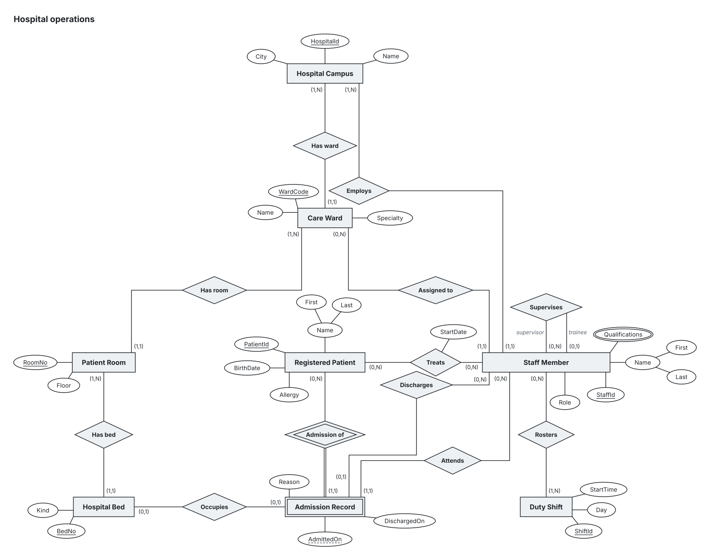

# Hospital operations

Model: campus.er.yaml

## Requirements

| # | Requirement | Model elements | Status |
| --- | --- | --- | --- |
| R1 | Each hospital has one or more wards, and every ward belongs to exactly one hospital. |  | Not applied yet |
| R2 | Every ward has one or more rooms; each room has one or more beds and belongs to exactly one ward. |  | Not applied yet |
| R3 | Staff members have an identifier, a composite name, a role and multiple qualifications; each staff member is assigned to exactly one ward. |  | Not applied yet |
| R4 | A staff member may supervise several trainees, and each trainee has at most one supervisor. |  | Not applied yet |
| R5 | Patients have an identifier, a composite name, a birth date and an allergy record; staff may treat many patients, recording the treatment start date. |  | Not applied yet |
| R6 | Each admission belongs to one patient and is identified by that patient and its admission date; it records a reason and an optional discharge date. |  | Not applied yet |
| R7 | An admission occupies at most one bed and has one attending staff member; its discharging clinician may be different. |  | Not applied yet |
| R8 | Hospitals employ staff members independently of ward assignments, and shifts roster one or more staff members. |  | Not applied yet |

## ER diagram

## Model

| Entity | Kind | Key | Attributes |
| --- | --- | --- | --- |
| Hospital Campus (HOSPITAL) | Strong | (HospitalId) | HospitalId, Name, City |
| Care Ward (WARD) | Strong | (WardCode) | WardCode, Name, Specialty |
| Patient Room (ROOM) | Strong | (RoomNo) | RoomNo, Floor |
| Hospital Bed (BED) | Strong | (BedNo) | BedNo, Kind |
| Staff Member (STAFF) | Strong | (StaffId) | StaffId, Name(First, Last), Role, \{Qualifications\} |
| Registered Patient (PATIENT) | Strong | (PatientId) | PatientId, Name(First, Last), BirthDate, Allergy |
| Admission Record (ADMISSION) | Weak | AdmittedOn | AdmittedOn, DischargedOn, Reason |
| Duty Shift (SHIFT) | Strong | (ShiftId) | ShiftId, Day, StartTime |

| Relationship | Degree | Participants (min,max) | Attributes | Identifying |
| --- | --- | --- | --- | --- |
| Has ward (HAS\_WARD) | 2 | Hospital Campus (HOSPITAL) (1,N), Care Ward (WARD) (1,1) |  | No |
| Has room (HAS\_ROOM) | 2 | Care Ward (WARD) (1,N), Patient Room (ROOM) (1,1) |  | No |
| Has bed (HAS\_BED) | 2 | Patient Room (ROOM) (1,N), Hospital Bed (BED) (1,1) |  | No |
| Assigned to (ASSIGNED\_TO) | 2 | Staff Member (STAFF) (1,1), Care Ward (WARD) (0,N) |  | No |
| Supervises (SUPERVISES) | 2 | Staff Member (STAFF) \[supervisor\] (0,N), Staff Member (STAFF) \[trainee\] (0,1) |  | No |
| Treats (TREATS) | 2 | Staff Member (STAFF) (0,N), Registered Patient (PATIENT) (0,N) | StartDate | No |
| Admission of (ADMISSION\_OF) | 2 | Registered Patient (PATIENT) (0,N), Admission Record (ADMISSION) (1,1) |  | Yes (Admission Record) |
| Occupies (OCCUPIES) | 2 | Hospital Bed (BED) (0,1), Admission Record (ADMISSION) (0,1) |  | No |
| Attends (ATTENDS) | 2 | Staff Member (STAFF) (0,N), Admission Record (ADMISSION) (1,1) |  | No |
| Discharges (DISCHARGES) | 2 | Staff Member (STAFF) (0,N), Admission Record (ADMISSION) (0,1) |  | No |
| Rosters (ROSTERS) | 2 | Staff Member (STAFF) (0,N), Duty Shift (SHIFT) (1,N) |  | No |
| Employs (EMPLOYS) | 2 | Hospital Campus (HOSPITAL) (1,N), Staff Member (STAFF) (1,1) |  | No |

## Traceability

No requirement has been applied to the model yet, so traceability is not available.

## Lint

| Severity | Rule | Message |
| --- | --- | --- |
| info | parallel-relationships | Relationships ATTENDS, DISCHARGES connect the same entities (ADMISSION, STAFF) and may record the same fact twice. Justified by note: "The discharging clinician can differ from the attending one recorded by ATTENDS." — No action needed unless the note no longer holds. |
| info | redundant-functional-path | EMPLOYS directly maps STAFF to at most one HOSPITAL, while the to-one path STAFF → ASSIGNED\_TO → WARD → HAS\_WARD → HOSPITAL stores the same fact (STAFF's HOSPITAL) twice and may disagree. Justified by note: "Employment is contractual with the hospital; ward assignment may change without changing the employer." — No action needed unless the note no longer holds. |

*0 errors does not mean the model is right; it means nothing obviously wrong was found.*

## Relational schema

PATIENT(<u>PatientId</u>, Name\_First, Name\_Last, BirthDate, Allergy)  
Step 1: E:PATIENT is regular; first candidate key is the PK, remaining candidate keys are UNIQUE.

HOSPITAL(<u>HospitalId</u>, Name, City)  
Step 1: E:HOSPITAL is regular; first candidate key is the PK, remaining candidate keys are UNIQUE.

SHIFT(<u>ShiftId</u>, Day, StartTime)  
Step 1: E:SHIFT is regular; first candidate key is the PK, remaining candidate keys are UNIQUE.

WARD(<u>WardCode</u>, Name, Specialty, HOSPITAL\_HospitalId)  
HOSPITAL\_HospitalId → HOSPITAL(HospitalId) [NOT NULL]  
Step 1: E:WARD is regular; first candidate key is the PK, remaining candidate keys are UNIQUE.  
Step 4: R:HAS\_WARD is 1:N (E:HOSPITAL 1..N, E:WARD 1..1); FK on E:WARD, the max=1 (relational N-side) end.

ROOM(<u>RoomNo</u>, Floor, WARD\_WardCode)  
WARD\_WardCode → WARD(WardCode) [NOT NULL]  
Step 1: E:ROOM is regular; first candidate key is the PK, remaining candidate keys are UNIQUE.  
Step 4: R:HAS\_ROOM is 1:N (E:WARD 1..N, E:ROOM 1..1); FK on E:ROOM, the max=1 (relational N-side) end.

BED(<u>BedNo</u>, Kind, ROOM\_RoomNo)  
ROOM\_RoomNo → ROOM(RoomNo) [NOT NULL]  
Step 1: E:BED is regular; first candidate key is the PK, remaining candidate keys are UNIQUE.  
Step 4: R:HAS\_BED is 1:N (E:ROOM 1..N, E:BED 1..1); FK on E:BED, the max=1 (relational N-side) end.

STAFF(<u>StaffId</u>, Name\_First, Name\_Last, Role, WARD\_WardCode, HOSPITAL\_HospitalId, supervisor\_StaffId)  
WARD\_WardCode → WARD(WardCode) [NOT NULL]  
HOSPITAL\_HospitalId → HOSPITAL(HospitalId) [NOT NULL]  
supervisor\_StaffId → STAFF(StaffId)  
Step 1: E:STAFF is regular; first candidate key is the PK, remaining candidate keys are UNIQUE.  
Step 4: R:ASSIGNED\_TO is 1:N (E:STAFF 1..1, E:WARD 0..N); FK on E:STAFF, the max=1 (relational N-side) end.  
Step 4: R:EMPLOYS is 1:N (E:HOSPITAL 1..N, E:STAFF 1..1); FK on E:STAFF, the max=1 (relational N-side) end.  
Step 4: R:SUPERVISES is 1:N (E:STAFF/supervisor 0..N, E:STAFF/trainee 0..1); FK on E:STAFF/trainee, the max=1 (relational N-side) end.

ADMISSION(<u>PATIENT\_PatientId</u>, <u>AdmittedOn</u>, DischargedOn, Reason, ATTENDS\_StaffId, DISCHARGES\_StaffId, BED\_BedNo)  
PATIENT\_PatientId → PATIENT(PatientId) [NOT NULL]  
ATTENDS\_StaffId → STAFF(StaffId) [NOT NULL]  
DISCHARGES\_StaffId → STAFF(StaffId)  
BED\_BedNo → BED(BedNo)  
UNIQUE(BED\_BedNo)  
Step 2: E:ADMISSION is weak, identified by R:ADMISSION\_OF; PK = owner PK(s) + partial key.  
Step 4: R:ATTENDS is 1:N (E:STAFF 0..N, E:ADMISSION 1..1); FK on E:ADMISSION, the max=1 (relational N-side) end.  
Step 4: R:DISCHARGES is 1:N (E:STAFF 0..N, E:ADMISSION 0..1); FK on E:ADMISSION, the max=1 (relational N-side) end.  
Step 3: R:OCCUPIES is 1:1 (E:BED 0..1, E:ADMISSION 0..1); FK on E:ADMISSION, the chosen end; both or neither end is total: choose the first entity/end id in lexical order.

ROSTERS(<u>STAFF\_StaffId</u>, <u>SHIFT\_ShiftId</u>)  
STAFF\_StaffId → STAFF(StaffId) [NOT NULL]  
SHIFT\_ShiftId → SHIFT(ShiftId) [NOT NULL]  
Step 5: R:ROSTERS is M:N (E:STAFF 0..N, E:SHIFT 1..N); PK = all participating PKs.

TREATS(<u>STAFF\_StaffId</u>, <u>PATIENT\_PatientId</u>, StartDate)  
STAFF\_StaffId → STAFF(StaffId) [NOT NULL]  
PATIENT\_PatientId → PATIENT(PatientId) [NOT NULL]  
Step 5: R:TREATS is M:N (E:STAFF 0..N, E:PATIENT 0..N); PK = all participating PKs.

STAFF\_Qualifications(<u>STAFF\_StaffId</u>, <u>Qualifications</u>)  
STAFF\_StaffId → STAFF(StaffId) [NOT NULL]  
Step 6: A:STAFF.Qualifications is multivalued; PK = owner PK + stored simple value components.

Notes:

- R:DISCHARGES: The discharging clinician can differ from the attending one recorded by ATTENDS.
- R:EMPLOYS: Employment is contractual with the hospital; ward assignment may change without changing the employer.
- R:EMPLOYS, EMPLOYS#0 (E:HOSPITAL 1..N): minimum participation 1 requires an assertion or trigger; FK/NOT NULL does not ensure a referenced entity has relationship rows.
- R:HAS\_BED, HAS\_BED#0 (E:ROOM 1..N): minimum participation 1 requires an assertion or trigger; FK/NOT NULL does not ensure a referenced entity has relationship rows.
- R:HAS\_ROOM, HAS\_ROOM#0 (E:WARD 1..N): minimum participation 1 requires an assertion or trigger; FK/NOT NULL does not ensure a referenced entity has relationship rows.
- R:HAS\_WARD, HAS\_WARD#0 (E:HOSPITAL 1..N): minimum participation 1 requires an assertion or trigger; FK/NOT NULL does not ensure a referenced entity has relationship rows.
- R:ROSTERS, ROSTERS#1 (E:SHIFT 1..N): minimum participation 1 requires an assertion or trigger; FK/NOT NULL does not ensure a referenced entity has relationship rows.
